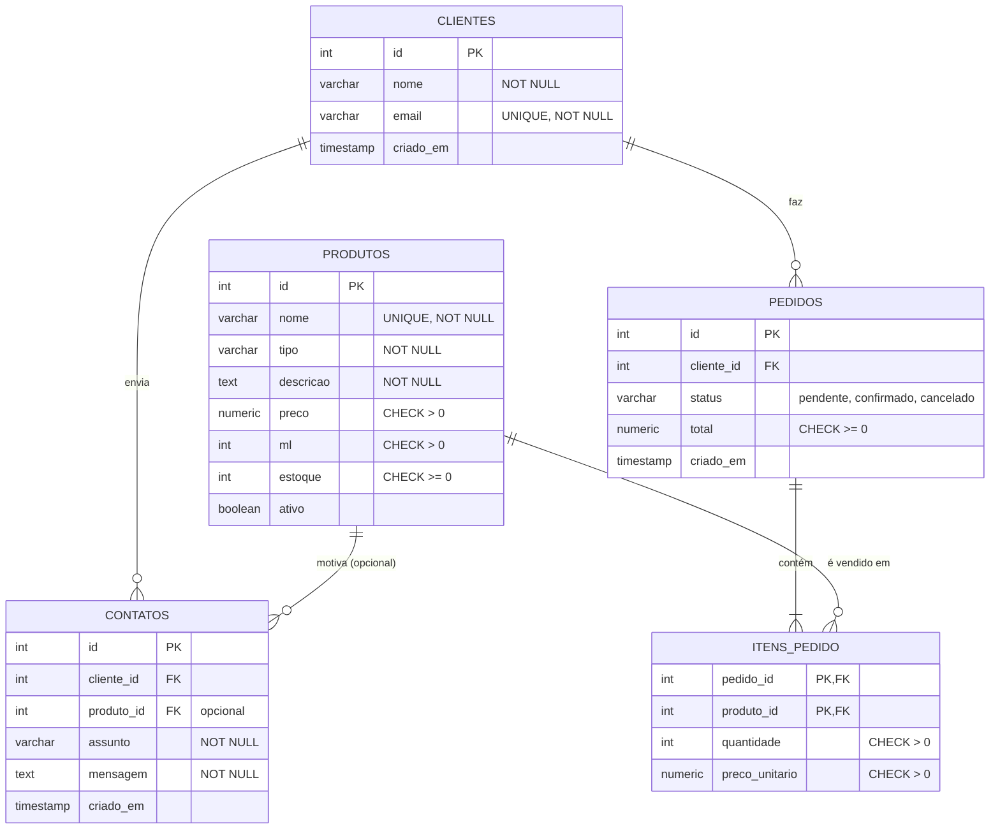

# Diagrama Entidade-Relacionamento (DER)

Imagem para o relatório: [`der.svg`](der.svg). A versão abaixo em Mermaid renderiza direto no GitHub.

## Relacionamentos
| Relação | Cardinalidade | Regra |
|---|---|---|
| clientes → contatos | 1:N | Apagar o cliente apaga os contatos (`ON DELETE CASCADE`) |
| produtos → contatos | 1:N (opcional) | Se o produto for apagado, o contato fica sem produto (`ON DELETE SET NULL`) |
| clientes → pedidos | 1:N | Não é possível apagar cliente com pedidos |
| pedidos → itens_pedido | 1:N | Apagar o pedido apaga os itens (`ON DELETE CASCADE`) |
| produtos → itens_pedido | 1:N | Não é possível apagar produto já vendido |

`itens_pedido` resolve a relação muitos-para-muitos entre pedidos e produtos (um pedido tem vários perfumes e um perfume está em vários pedidos). O `preco_unitario` guarda o preço no momento da compra.
